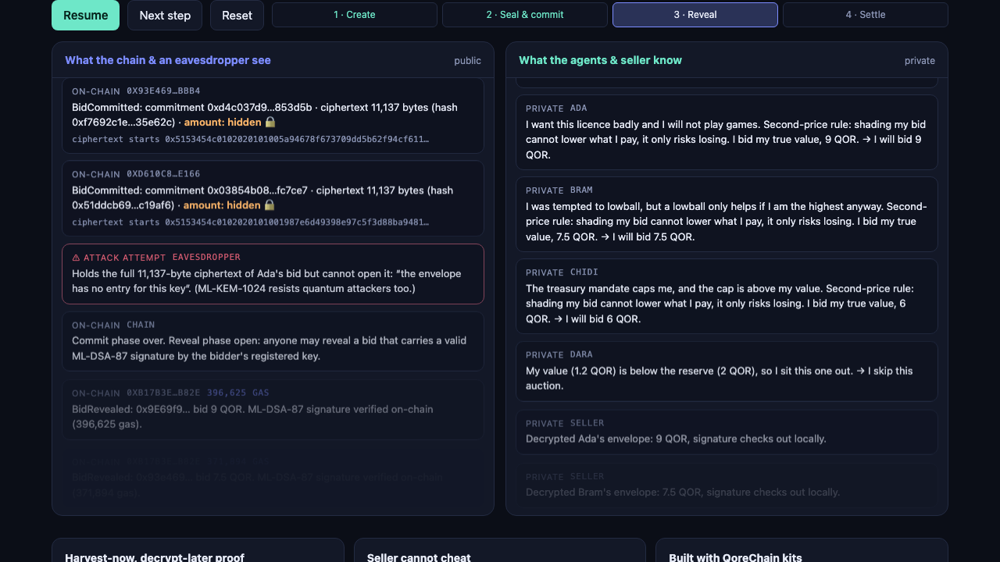

# SealedBid

**Sealed-bid auctions where AI agents bid in secret, secured end to end by post-quantum cryptography on QoreChain.**



Built for the QoreChain *Build Before Q-Day* developer fest, category **Encrypted Apps**.
Testnet only. Test tokens have no value. MIT licensed.

## The problem

Auctions leak. Every bid on a public chain is visible to validators, other bidders and front-runners, and anything
encrypted with classical crypto today can be recorded now and decrypted when quantum computers arrive
("harvest now, decrypt later"). Worse, a classical key that leaks later can move funds that were meant to be safe.

## What SealedBid does

1. **Seal.** A bidder (a human or a Claude-powered agent) encrypts their bid to the seller's registered
   **ML-KEM-1024** key with QoreSeal, and signs it with their **ML-DSA-87** key. Only a salted commitment and the
   hash of the ciphertext go on-chain. Nobody sees an amount before the reveal.
2. **Reveal.** The seller decrypts and reveals bids on the bidders' behalf ("bid and walk away"), or any bidder reveals
   their own. The contract verifies every signature on-chain against the bidder's *registered* key through the
   `pqcVerify` precompile.
3. **Settle.** Second-price (Vickrey) rule: the highest bidder wins and pays the second-highest bid, which makes
   bidding your true value the dominant strategy. Every deposit and every payout needs an ML-DSA signature.

### Why each guarantee holds

| Guarantee | Mechanism |
|---|---|
| Bids stay secret until reveal | Commitment + ML-KEM-1024 envelope; ciphertext is bound to one auction + bidder via AAD |
| Secret against quantum attackers | ML-KEM-1024 (FIPS 203) for confidentiality, ML-DSA-87 (FIPS 204) for authenticity |
| Seller cannot forge or alter a bid | Reveal needs the bidder's ML-DSA signature over amount + salt, verified on-chain |
| Seller cannot censor a bid | Anyone can call `reveal`; a bidder can reveal their own bid themselves |
| A leaked ECDSA key cannot steal | `withdraw` **and** `commitBid` require an ML-DSA signature from the registered key |
| Signatures cannot be replayed | Domain-separated digests include chain id, contract, auction id; withdrawals use a nonce |

Details and the attack matrix are in [docs/THREAT_MODEL.md](docs/THREAT_MODEL.md).

## Architecture

```
 bidder / Claude agent                 seller (auctioneer)                  QoreChain testnet
 ────────────────────                  ───────────────────                  ─────────────────
 decide bid (LLM, clamped)
 seal(bid, sig) ──► ML-KEM-1024 envelope ─────────────────────────────────► commitBid(commitment,
 sign(commit digest) ───────────────────────────────────────────────────────► envelopeHash, ML-DSA sig)
                                         open envelope (own ML-KEM key)
                                         check ML-DSA sig locally
                                         reveal(amount, salt, sig) ─────────► pqcVerify precompile (0x0a01)
                                                                              pqcKeyStatus (0x0a02)
                                                                              pick winner, 2nd price
 payWinning / withdraw(ML-DSA sig) ─────────────────────────────────────────► pull payments
```

* `contracts/SealedBidAuction.sol` — the auction (commit–reveal, second price, PQ-gated money flow).
* `src/sealedbid/core.ts` — digests, commitments, `sealBid` / `openBid` (browser + Node).
* `src/agents/bidder.ts` — Claude-powered bidder agents with a deterministic fallback; the model's answer is clamped to
  the agent's own budget and the reserve, so an LLM can advise but never overspend.
* `src/sealedbid/demo.ts` — runs a whole auction and records a two-lane transcript (what the chain sees vs. what the
  agents know). The UI replays it.
* `scripts/testnet.ts` — `status | probe | setup | demo` against QoreChain testnet.

## Run it

```bash
npm install
npm test                 # compiles the contract and runs 18 tests on an in-process chain
npm run demo:local       # records public/demo-log.json (set ANTHROPIC_API_KEY to use Claude as the bidders)
npm run dev              # open http://localhost:5173 and press "Play auction"
```

Without `ANTHROPIC_API_KEY` the agents use a deterministic fallback (bid your true value), so everything runs offline.

### On QoreChain testnet

```bash
npx tsx scripts/00-keygen.ts deployer   # also: auctioneer, bidder1, bidder2, bidder3 (keys land in ./keys, gitignored)
# fund each address from https://dashboard.qorechain.io/faucet
npm run testnet -- status   # balances, PQ key, KEM key, window per account (read-only)
npm run testnet -- setup    # register PQ keys (with proof of possession), publish seller KEM key, deploy
npm run testnet -- demo     # one full auction on testnet, recorded to public/demo-log.json
```

## What is verified, and how

Honesty matters more than a long feature list, so here is exactly what has and has not been proven.

**Verified against the real QoreChain testnet** (`npx tsx scripts/03-precompile-probe.ts`, read-only `eth_call`):
* the `pqcKeyStatus` precompile (`0x…0a02`) is live and the ABI decodes;
* the `pqcVerify` precompile (`0x…0a01`) accepts an SDK-made ML-DSA-87 signature over the **raw 32-byte digest** the
  auction signs, and rejects a tampered message and a wrong public key (deterministic and hedged signatures both work).

**Verified locally with a mock precompile** (18 tests, in-process EVM): all auction logic, second-price maths, money
flow to the wei, ties, censorship fallback, non-paying winner, reserve handling, Q-Day attacks (stolen-key withdraw,
stolen-key deposit lock, signature replay), digest parity between TypeScript and Solidity, and the sealing layer.
The mock whitelists a signature the harness has already verified with the real ML-DSA library, so the contract sees
the same call shape as the real precompile. It does not prove the precompile's behaviour. The section above does.

**Not yet verified on testnet** (needs funded accounts; the pipeline is written and typechecked):
registering the PQ key with proof of possession, publishing the ML-KEM key, opening windows, deploying the auction,
a contract calling the precompile from inside a windowed transaction, and the full recorded demo. Until then the
recording in the UI is labelled as a local run. If the in-transaction precompile call fails, the documented fallback is
commitment-only mode (signatures checked off-chain by the seller; the commitment still binds the bid).

## Known limitations

* The seller (auctioneer) *can read* bids; the design stops them from cheating, not from knowing. Hiding bids from the
  seller too needs threshold decryption, which is future work.
* One bid per address per auction; native QOR only.
* Each ML-DSA verification costs about 90k gas plus ~7 KB of calldata, so reveals are batched per transaction.
* QoreSeal is pre-1.0 and awaiting external review per its authors. Only payload confidentiality is provided;
  addresses, timing and sizes are public.
* Timing uses `block.timestamp`.

## AI usage

See [AI_USAGE.md](AI_USAGE.md): Claude Code helped build this, and Claude is the brain of the bidder agents at runtime.

## Credits

Scaffolded from `create-qorechain-dapp` (fullstack-web). Uses the QoreChain SDK (`@qorechain/sdk`) and QoreSeal
(`@qorechain/qoreseal`), both Apache-2.0. Project code is MIT, see [LICENSE](LICENSE).
